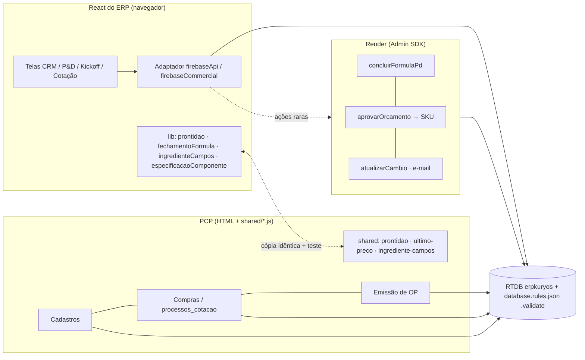

# PROMPT DE ENGENHARIA — KURYOS · Pacote 21/10/2026 (adaptado ao Firebase)

**Escopo:** lotes de amostra (P&D) · cadastro de MPs · aprovações comerciais · Kickoff ·
Cotação → Orçamento → SKU · PCP · arquitetura de paralelismo Projeto × Kickoff.

Versão adaptada (22/10/2026) do prompt recebido, que assumia FastAPI + MongoDB. **Nada
implementado.** Substitui o rascunho `PLANO_FLUXO_AMOSTRA_OP.md`, cujos achados foram
incorporados aqui. A **Parte A** é o prompt de execução; a **Parte B**, a viabilidade
item a item, conferida no código; a **Parte C**, o planejamento estrutural.

**Revisão 2 (22/10/2026), com as decisões do usuário:**

| Tema | Decisão |
|---|---|
| Q15 | Autorizado. Como "estamos rodando tudo aqui", a fonte React do CRM vem para dentro deste repo (INF-01). O backend Mongo/FastAPI está abandonado e não é tocado. |
| Q14 | O `tenant_id` dos usuários é corrigido pela **operação** (INF-03 entrega a lista e o passo a passo). |
| Q11 + dólar | Sem congelamento. A taxa é gravada **como número** e **como texto** no histórico do cliente em cada etapa (log de auditoria), e o documento usa a taxa da sua etapa (COM-01). |
| Q16 | Sem q.s.p. automático. Faltou %, abre popup vermelho e a correção é responsabilidade da Química (AMO-03). |
| Q12 | Não respondida. Vale a premissa da opção A (cotação em nó próprio), a confirmar antes da Onda 4. |
| KO-09 (CGI) e PCP-01 (etiquetas) | Ficam **por último** (Onda 6), aguardando instruções. Ao terminar as Ondas 0–5, avisar o usuário de que faltam as instruções desses dois. |

> **Como executar (Claude Code):** uma fase por vez. Em cada fase: (1) auditar e
> reportar o estado atual, (2) propor o plano, (3) aguardar aprovação, (4) implementar
> com commits atômicos por item, (5) rodar os testes e entregar o relatório da seção
> A.12. Itens com ⚠️ dependem de resposta da seção A.11: implemente o resto da fase e
> deixe esses por último.

---

# PARTE A — Prompt adaptado

## A.0 Seu papel

Engenheiro(a) de software sênior full-stack do ERP industrial da Kuryos (fabricante
*private label* de cosméticos, licenciada pela Anvisa). As decisões de modelagem
priorizam integridade de dados, rastreabilidade e compatibilidade com o legado. Quando a
especificação for ambígua, registre a premissa no relatório. Se a decisão for difícil de
reverter (modelo de dados, numeração, migração, regra do banco), pare e pergunte.

## A.1 Contexto do sistema (real, conferido em 22/10/2026)

| Camada | O que é | Onde |
|---|---|---|
| Banco | **Firebase Realtime Database**, projeto **`erpkuryos`**, plano Spark. Um banco só para PCP e ERP. **Não há MongoDB nem Postgres em uso.** | `https://erpkuryos-default-rtdb.firebaseio.com` |
| Login | Firebase Auth (`erpkuryos`); perfil em `usuarios/{uid}` (`role`, `modulos`, `tenant_id`) | `public/login.html`, `auth_check.js` |
| PCP | HTML + JS sem build; módulos UMD em `public/shared/*.js` | repo `gcallegaro-kur/PCP-Kuryos`, branch `main` |
| CRM/P&D/Kickoff/Cotação/CGI | Telas React (shadcn/ui) **compiladas para `public/static/crm`** e servidas pelo PCP (`/crm-app`). Este repo guarda só o JavaScript compilado (1.439 arquivos); o código que se edita está na pasta `frontend/` do projeto antigo. | Hoje: `../KURYOS/ERPKuryosBeauty-master/frontend/src`. **Depois do INF-01: `crm-frontend/` neste repo.** O `backend/` em Python/Mongo daquela pasta está abandonado e nunca é usado. |
| "Backend" do ERP | **Adaptador que roda no navegador**: `lib/firebaseApi.js` + `lib/firebaseCommercial.js` simulam as rotas HTTP antigas (`api.post("/kickoff/...")`) e respondem 4xx com `apiError`. Dados em `erp/kuryos/{coleção}/{id}`. | idem |
| Servidor | Funções do PCP (`functions/index.js`) rodando no **Render, plano gratuito** (`functions/render-server.js` emula `onCall`/`onRequest`/gatilhos/agenda com Admin SDK). O frontend do ERP **não chama** nenhuma. | `render.yaml` |
| Regras | `database.rules.json` **do repo do PCP** é a única fonte | PCP |
| Testes | ERP: **Vitest** (209 testes). PCP: `node run_*_test.js` (~200 arquivos) + regras no emulador (`run_*_rules_test.js`). E2E: Playwright com emuladores (scratchpad). | — |
| Deploy | Build do ERP → `scripts/integrar-crm-build.mjs` → `public/static/crm` → hosting + commit + push no mesmo turno (CLAUDE.md) | — |

**Arquivos reais** (no lugar dos `*_routes.py` do prompt original): `PDDetail.js`,
`SampleBatchModal.js`, `CRM2Page.js`, `CRM3Page.js`, `KickoffPage.js`,
`KickoffCompositionQuestionnaire.js`, `ContratosPage.js`, `CommercialBudgetPage.js`,
`components/CotacaoComposicao.js`, `lib/{firebaseApi,firebaseCommercial,cotacao,cambio,
pdCards,numeracaoProjeto,filaCadastroMp,crmRules}.js`. No PCP: `cadastros.html`,
`compras.html`, `emitir_op.html`, `retrabalhos.html`, `shared/{sku-entrada,servicos,
pendencias-setor,cambio,etiqueta-caixa,retrabalho-op}.js`.

**Especificações anteriores** (R01–R33, `PROMPT_HOTFIX_BETA_KURYOS.md`) são da época
Mongo/FastAPI e não estão neste repo. Vale o que o código e os documentos vivos
(`PLANO_PD_CRM_AJUSTES.md`, `CLAUDE.md`) registram. Equivalentes conhecidos:

- R28–R30 (codificação) → contador `config/contadores/sku/{CAT}_{CLI}`;
- R31 (versão de BOM) → `bom/{SKU}__vN`;
- R32 (titularidade) → `shared/propriedade-estoque.js`;
- R33 (rendimento) → **a confirmar**.

**R11:** hoje a SKU nasce na **assinatura do CGI** (não na aprovação da amostra). Passa a
nascer na aprovação do orçamento (COM-07).

**Convenções a reutilizar:**

- **Numeração:** projeto `2026-031`, amostra `2026-031-A1`, variação `2026-031-A1-a`
  (base 26), Kickoff `KO-2026-031` (`lib/numeracaoProjeto.js`), revisão do Kickoff `vN`
  com justificativa (Fase 2 de 15/10).
- **Contadores:** `nextCounter` por `.transaction()`.
- **Câmbio:** `config/cambio/usd_brl`, atualizado a cada 15 min por AwesomeAPI → PTAX BCB
  → ExchangeRate-API.
- **Serviços:** tabela `servicos/`.
- **Fila de MP nova:** `solicitacoes_cadastro_material/`.
- **Pendências por setor:** `pendencias_setor/`.

## A.2 Regras de engenharia (adaptadas)

1. **Audite antes de implementar.** Classifique cada item como `já existe` / `parcial` /
   `não existe` / `conflitante`, citando `arquivo:linha`. O que já existe não é
   reescrito. A Parte B traz a primeira auditoria: confirme antes de usar.
2. **Garantia em três camadas.** "O backend é a fonte da verdade" não vale do jeito do
   prompt original: o adaptador do ERP roda no navegador e qualquer usuário do tenant
   escreve em `erp/kuryos/*`. Toda trava fica na **camada mais baixa que consegue
   verificá-la**:
   - **(a) Regra do banco** (`.validate`), para fatos gravados: status aprovado,
     existência de vínculo, chave única. `.validate` vale nos filhos mesmo quando o
     `.write` do pai é amplo. Esta é a camada preferida.
   - **(b) Função no servidor** (`onCall` no Render, Admin SDK), para o que a regra não
     calcula: soma de %, prontidão composta, geração idempotente de SKU. Nesse caso a
     regra **proíbe o cliente** de gravar o status final, e só o servidor grava.
   - **(c) Adaptador e tela**, que explicam a trava: o adaptador responde 422/409 com
     `{codigo, pendencias[]}` e a tela mostra.

   Nenhuma trava existe só em (c).
3. **Documento aprovado é imutável.** Amostra aprovada, Kickoff congelado, cotação e
   orçamento aprovados, fórmula versionada: mudança gera revisão vinculada. Na regra:
   `.validate` com `!data.exists() || data.child('status').val() != 'aprovado'`.
4. **Trilha de auditoria.** Toda transição grava quem (`uid` + nome), quando (ISO UTC
   no banco, exibido em America/Sao_Paulo), de → para e motivo. No ERP, reutilize
   `auditCard`/`log_auditoria`; no PCP, o histórico do próprio nó.
5. **Números.** JavaScript não tem `Decimal` e o RTDB guarda `double`. As contas de % e
   quantidade usam **inteiros escalados** (% × 10⁴) numa função pura; o banco guarda
   com no máximo 4 casas; arredondar só na apresentação.
   `TOLERANCIA_FORMULA = 0.001` (pontos percentuais) numa constante só. Hoje convivem
   0,5 (`firebaseApi.js:1771`) e 0,01 (`PDDetail.js:2303`).
6. **Migrações no RTDB:**
   - backup JSON antes;
   - modo de ensaio (dry-run) com contagens;
   - **caminhos planos** (`no/id/campo`): update com objeto aninhado apaga campos (já
     destruiu 375 produtos);
   - rodar em **um** registro, conferir, depois o resto;
   - idempotente e reexecutável.

   Escrita em produção que eu não tenho permissão de fazer vai para o usuário com o
   script pronto.
7. **Uma fonte por dado.** O que é compartilhado entre o ERP (ESM), o PCP (UMD) e as
   funções (CJS) segue o padrão `cambio.js`: uma fonte, cópias byte a byte e um teste
   que falha se elas divergirem.
8. **Concorrência.** Sequenciais por `.transaction()`, nunca `count() + 1`. Armadilha
   do RTDB: o callback roda primeiro com `null` do cache local. Contador trata `null`
   como 0; transação sobre documento existente usa `if (!atual) return atual;`, nunca
   `return;`.
9. **Commits atômicos** com o ID no prefixo (`feat(KO-04): ...`), sempre neste repo
   (depois do INF-01 a fonte React também está aqui). Commit + push + deploy no mesmo
   turno. O repo antigo `DEVMarlosGomes/ERPKuryosBeauty` não recebe mais commit.
10. **Testes.** Cada critério de aceite vira teste:
    - Vitest para regras do ERP;
    - `run_*_test.js` para regras do PCP;
    - `run_*_rules_test.js` no emulador para toda regra de banco nova;
    - E2E com emuladores para o que é de tela.

    Antes de fechar, **ensaio do motor contra a base real sem gravar** (lição do MRP).
    Suíte inteira verde ao fim de cada fase.
11. **Escopo fechado.** Bug alheio vai para o relatório e para `MELHORIAS_FUTURAS.md`,
    não para o mesmo commit.
12. **Papel novo** entra em `pageAccessRules`, menu, `login.html`, `usuarios.html` e
    `database.rules.json`. No ERP, também em `RoleGuard` e no `tenant_id` do perfil.

## A.3 Glossário (ajustado ao sistema)

| Termo | Significado |
|---|---|
| Projeto | `erp/kuryos/crm_projects/{id}`, numerado `2026-031`; contém amostras. |
| Amostra / Variação | `crm_samples` `2026-031-A1`; variações `-a`, `-b`… (normalmente só a fragrância muda). No P&D: `pd_requests`/`pd_developments`/`pd_formulas` com versões V1, V2… |
| Lote de amostra | Lote no P&D (`/pd/developments/{id}/sample-batches`) com fórmula base e variantes. |
| Formulação base | Ingredientes comuns às variações (água, álcool, conservantes…), sem a fragrância. |
| MPGR / MPES | Prefixos de código de MP nova. **MPES = fragrância/essência**: exige SKU de aprovação e depois SKU final (`shared/sku-entrada.js`). **MPGR = demais MPs.** |
| Kickoff (KO) | `erp/kuryos/kickoffs/{id}`, questionário de composição em blocos 0–5 + fechamento + BOM + aprovações. |
| CGI | Contrato Geral de Industrialização (`erp/kuryos/contratos`). Hoje é **um por Kickoff**; o alvo é um por cliente (KO-09). |
| Cotação | Hoje: `crm_propostas/{id}.composicao` (preço montado pelo Comercial, Fase 7). Compras cota com fornecedores em `processos_cotacao/` do PCP. Ver decisão D-3. |
| Orçamento | Decisão do cliente sobre a proposta (`negociacao_status`). |
| BOM | No Kickoff: `kickoffs/{id}/bom`. No PCP, por SKU: `bom/{SKU}__vN`, separada de `formulas/{SKU}__vN` e `especificacoes/{SKU}__vN`. |
| OP | `emitir_op.html` (PCP). |

## A.4 Mapa de itens

P0 = integridade, dinheiro ou bloqueio operacional · P1 = fluxo principal · P2 =
melhoria. A coluna "Estado" é a auditoria da Parte B.

| ID | Item | Prio | Fase | Estado | Depende de |
|---|---|---|---|---|---|
| INF-01 | Trazer a fonte React do CRM para este repo (`crm-frontend/`) | P0 | 0 | não existe | — |
| INF-02 | Regras do banco com fonte única | P0 | 0 | conflitante | — |
| INF-03 | `tenant_id` dos usuários (correção pela operação) | P0 | 0 | conflitante | — |
| INF-04 | Camada de travas no servidor (`onCall` no Render) + `.validate` | P0 | 0 | parcial | INF-02 |
| AUD-01 | Auditoria formal (completa a Parte B) | P0 | 0 | parcial | — |
| ARQ-01 | RFC projeto e Kickoff em paralelo | P1 | 0 | — | AUD-01 |
| AMO-01 | Passo a passo acima, lotes abaixo | P2 | 1 | conflitante | — |
| AMO-02 | Formulação base no lote, reutilizada no projeto | P1 | 1 | parcial | AMO-04 |
| AMO-03 | Conclusão bloqueada se não fechar 100% | P0 | 1 | parcial | INF-04 |
| AMO-04 | MP nova com os mesmos campos do ingrediente (INCI → US$) | P0 | 1 | parcial | — |
| CAD-01 | Cadastro verifica duplicidade e vincula MP existente | P0 | 2 | não existe | AMO-04 |
| COM-01 | Câmbio: sem congelamento; taxa em número + texto no histórico do cliente a cada etapa | P0 | 2 | conflitante | — |
| COM-02 | Modal de aprovação do cliente | P1 | 2 | parcial | — |
| AMO-05 | "Retrabalhar amostra" após aprovação | P1 | 2 | não existe | ARQ-01 |
| KO-01 | `KO-2026-031 — Abelhinha` | P2 | 3 | parcial | — |
| KO-02 | Kickoff autopopulado com origem | P1 | 3 | parcial | ARQ-01 |
| KO-03 | Sim/não em três estados: "Não" é resposta, "Sim" exige complemento | P1 | 3 | conflitante | — |
| KO-04 | Componentes em menu com especificação dinâmica | P1 | 3 | não existe | — |
| KO-05 | Fornecido por / especificação / fornecedor / código pelo Cadastros | P1 | 3 | não existe | CAD-01 |
| KO-06 | Cadastro de responsável técnico | P2 | 3 | não existe | — |
| KO-07 | Aprovação do Comercial responsável pelo cliente | P1 | 3 | não existe | — |
| KO-08 | Seleção de serviços | P1 | 3 | não existe | — |
| KO-09 | CGI vigente reaproveitado por cliente — **por último, aguarda instruções** | P2 | 6 | conflitante | Q13 |
| BOM-01 | BOM por nível de embalagem; manipulação em documento separado | P1 | 3 | parcial (defeito) | KO-04 |
| COM-03 | Cotação herda 100% do Kickoff ⚠️ Q12 | P1 | 4 | parcial | Fase 3 |
| COM-04 | Preço sugerido pela última compra; Compras atualiza | P1 | 4 | parcial | COM-03 |
| COM-05 | Texto de solicitação de cotação ao fornecedor | P2 | 4 | **já existe** | COM-03 |
| COM-06 | Orçamento; reprovação reabre a cotação | P1 | 4 | conflitante | COM-04 |
| COM-07 | SKU gerada na aprovação do orçamento | P1 | 4 | conflitante | COM-06, INF-04 |
| PCP-01 | Etiquetas de retrabalho — **por último, aguarda instruções** | P1 | 6 | não encontrada | Q6 |
| PCP-02 | OP só com 100% de prontidão | P0 | 5 | parcial | COM-07, BOM-01 |

## A.5 FASE 0 — Infraestrutura, auditoria e arquitetura

### INF-01 · Trazer a fonte React do CRM para este repo `P0` (Q15 autorizada)
**O que é a "fonte".** As telas CRM1/2/3, P&D, Kickoff, Cotação e Contratos que rodam
em `/crm-app` são React. Este repo tem só o resultado compilado (`public/static/crm`,
1.439 arquivos), que não dá para editar. O código que se edita é a pasta `frontend/` do
projeto antigo (`../KURYOS/ERPKuryosBeauty-master/frontend`, 3,8 MB de `src`). Ela já
grava no Firebase (`lib/firebaseApi.js`), **não no Mongo**. O que está abandonado
naquela pasta é o `backend/` em Python. O problema: essa `frontend/` está fora do Git
deste repo, com 54 arquivos sem commit desde 09/10, entre eles todos os motores das
Fases 1–7. Hoje, um disco perdido apaga esse código.

**O que fazer:**
- copiar `frontend/` para `crm-frontend/` neste repo, sem `node_modules/` e `build/`
  (`.gitignore`), registrando na mensagem do commit a origem (`a6892e6` + alterações
  locais);
- ajustar o caminho padrão de `scripts/integrar-crm-build.mjs` para
  `crm-frontend/build`;
- Vitest (209) roda daqui;
- CLAUDE.md e AGENT_STATUS passam a apontar para `crm-frontend/`;
- a pasta antiga fica só como arquivo morto, sem commit novo.

**Aceite:**
- `crm-frontend/` versionado;
- `npm ci && npx vite build --assetsDir static/crm` + o script de integração geram um
  build idêntico ao publicado;
- Vitest 209/209.

### INF-02 · Regras com fonte única `P0`
`../KURYOS/ERPKuryosBeauty-master/database.rules.json` (sem commit) é uma cópia velha
das regras do PCP. Faltam `pendencias_setor`, `servicos` e `solicitacoes_cadastro_material`,
e o `firebase.json` de lá aponta para o mesmo `erpkuryos`: **publicar a partir daquela
pasta apagaria esses três nós em produção**. Remover a cópia (ou trocar por um aviso) e
registrar no CLAUDE.md que só se publica pelo PCP.
**Aceite:** um só arquivo de regras para `erpkuryos`.

### INF-03 · Usuários sem `tenant_id` `P0`
A regra de `erp/$tenant` (`database.rules.json:467–473`) libera só ADM ou quem tem
`tenant_id = kuryos`, e **só 1 de 14 usuários ativos tem** (achado de 15/10). Os fluxos
novos põem Compras, Cadastros e Qualidade para ler e escrever em `erp/kuryos/*`
(cotação, solicitações, aprovações). Sem o tenant, vão dar PERMISSION_DENIED.

**Q14: a correção é da operação.** Entrego:
- a lista (só leitura) de quem opera o fluxo e está sem tenant;
- o passo a passo: Usuários › Funções do usuário › salvar. O cálculo
  `perfilDasFuncoes` já grava o `tenant_id` junto com funções e módulos.

Código só se a lista mostrar que salvar as funções não basta.

**Aceite:** lista entregue antes da Onda 4, que é quando Compras passa a usar o ERP.
Teste de regra no emulador por papel.

### INF-04 · Camada de travas `P0`
Formalizar o padrão da regra A.2.2:
- função `onCall` no Render com papel conferido no servidor (padrão
  `criarRascunhoCotacao`, `functions/index.js:596`);
- cliente no ERP via `firebase/functions` apontando para o Render, como o PCP faz em
  `auth_check.js:7`;
- regra que nega ao cliente os campos que só o servidor grava;
- teste de regra.

**Risco medido:** Render gratuito dorme depois de 15 min, e a primeira chamada leva
30–60 s. Por isso a função entra só nas ações raras e de alto valor (concluir fórmula,
aprovar orçamento → SKU). O resto vai em `.validate`.
**Aceite:** uma ação piloto (AMO-03) passa pelas três camadas, com teste de regra
provando que o cliente não grava o status sozinho.

### AUD-01 · Auditoria `P0`
Entregar `AUDITORIA_PACOTE_20261021.md` (raiz do repo, convenção dos documentos vivos),
partindo da Parte B:
- fluxo atual em Mermaid (amostra → Kickoff → cotação → orçamento → CGI → SKU → pedido
  → OP);
- lista campo a campo de ingrediente × MP nova × material do Cadastros;
- opções embutidas nos rótulos dos componentes do Kickoff;
- **medições na base, só leitura** (pelo navegador, como em 15/10, porque a CLI do
  Firebase não autenticou neste ambiente):
  - projetos com mais de uma variação aprovada em datas diferentes (decide a V2 do
    ARQ-01);
  - MPs duplicadas hoje entre os 906 materiais (decide a migração do CAD-01);
  - Kickoffs legados com sim/não (KO-03);
  - produtos ativos com Fórmula + BOM + Especificação aprovadas (decide a virada do
    PCP-02).

**Aceite:** relatório entregue; nenhuma linha de código de produção alterada.

### ARQ-01 · RFC — projeto e Kickoff em paralelo `P1`
Manter o problema, o princípio (separar informação de compromisso), as vertentes
V1–V4 e as regras transversais do prompt original, com estes ajustes à base real:

- **V4 já existe em parte.** O Kickoff aprovado só muda com justificativa e gera nova
  versão (`vN`, anterior no histórico, motivo no `log_auditoria`). A RFC estende isso a
  cotação e orçamento e acrescenta a marca "desatualizado" com diff. Mantém-se `vN`
  (não `rev.A`) para não renumerar o que existe.
- **V1 já existe em parte.** `blocos_status` calcula `completo`/`campos_pendentes` por
  bloco (`firebaseCommercial.js:170–178`), mas não há máquina de estados nem
  proveniência. Hoje o Kickoff só abre com amostra aprovada + fórmula registrada
  (`firebaseCommercial.js:896`); a V1 o abre como rascunho junto com o projeto. Isso
  muda `crmRules` (etapa Kickoff do CRM2) e o pareamento `etapaPelaAmostra`.
- **Eventos.** Não há barramento. Proposta: coleção-outbox `erp/kuryos/eventos/{id}`
  gravada pelo adaptador no mesmo update multi-caminho da mudança, mais tratadores no
  próprio adaptador (síncronos, como pede a RFC). Gatilhos `onValueCreated` no Render
  ficam para quando houver V3; o padrão já existe (`onPedidoComercialCriado`).
- **V2** só se a medição do AUD-01 mostrar volume de projetos com várias SKUs aprovadas
  em datas diferentes.
- **Prontidão:** função pura `calcularProntidao(entidade) → {percentual, pendencias[]}`
  com uma fonte (A.2.7), usada pelo Kickoff (ERP), pela cotação (ERP) e pela OP (PCP).

**Entregável:** `RFC_001_PROJETO_KICKOFF_PARALELO.md`, com:
- modelo de dados em caminhos do RTDB;
- máquina de estados por bloco;
- catálogo de eventos;
- regras de invalidação;
- migração dos Kickoffs existentes (aprovado → `congelado`, `v1` mantida);
- impacto por item;
- riscos e estimativa.

**Pare e aguarde aprovação.**

## A.6 FASE 1 — P&D

### AMO-01 · Passo a passo acima, lotes abaixo `P2`
**Atenção:** em 17/10 a "Descrição de elaboração (fases + passo a passo)" foi para
**baixo** dos Lotes de Amostras, a pedido do usuário (`PDDetail.js:2413`). Este item
inverte isso. Só layout. **Aceite:** ordem Passo a passo → Lotes; nenhum teste quebra.

### AMO-02 · Formulação base no lote, reutilizada no projeto `P1`
Comportamento do prompt original, mantido. Modelo no RTDB:

```
erp/kuryos/pd_formulacoes_base/{id}
  projeto_id, versao (1,2,3…), origem_lote_id, criado_por, criado_por_nome, criado_em,
  usada_em_lote: bool                          ← true = imutável (regra .validate)
  itens/{itemId}: { ...CAMPOS_INGREDIENTE (AMO-04), fase, percentual }
lote (coleção existente dos sample-batches):
  + formulacao_base_id, formulacao_base_versao
  + fragrancias/{letraVariacao}: { ...CAMPOS_INGREDIENTE, percentual }
```

- Hoje o lote já grava `base_reference_items` por lote (`PDDetail.js:3067`) a partir da
  fórmula base, sem a fragrância (`2946–2963`). Migrar para a referência versionada;
  lotes antigos continuam lendo `base_reference_items`.
- "Ingredientes da base" acima de "Observações do lote" (hoje a base aparece **antes**
  do seletor da fórmula de onde ela vem, `3164–3223`).
- Variação: hoje substitui qualquer ingrediente por qualquer MP (`3255–3315`). Passa a
  editar só a fragrância.
- **Sem q.s.p. automático (Q16).** Nenhum ingrediente absorve a diferença sozinho. Se a
  % da fragrância nova deixar a variante fora dos 100%, vale o AMO-03: popup vermelho, e
  a Química completa.

**Aceite:** o do prompt original, com mais um caso: lote antigo, sem
`formulacao_base_id`, abre sem erro.

### AMO-03 · 100% para concluir `P0`
- Hoje só existe na passagem para "Em Testes", só olha a última versão da fórmula base,
  tolera ±0,5 e avisa por toast (`firebaseApi.js:1770–1771`). As variantes do lote não
  são conferidas (total exibido em `PDDetail.js:3459`).
- Novo:
  - função pura `fechamentoFormula(itens) → {soma, diferenca, ok}` com inteiros
    escalados e `TOLERANCIA_FORMULA`;
  - vale para a fórmula de manipulação e para **cada variante resolvida** (base +
    fragrância);
  - diálogo vermelho (AlertDialog destrutivo) com soma, "falta X%" / "excede X%", a
    variante e os itens;
  - **Q16:** o texto diz que **a correção é responsabilidade da Química** e mostra o
    formulador responsável pelo desenvolvimento. O sistema não completa nada sozinho:
    a Química ajusta a fórmula e só então conclui;
  - salvar rascunho segue permitido.
- **Garantia (INF-04):** `IN_TESTS` e `WAITING_APPROVAL` passam a ser gravados pela
  função `concluirFormulaPd` no Render, que recalcula a soma. A regra `.validate` em
  `erp/$tenant/pd_requests/$id/status` recusa esses dois valores vindos do cliente. O
  adaptador devolve 422 `{codigo: "FORMULA_NAO_FECHA_100", soma, diferenca, itens}`.

**Aceite:** os cinco do prompt original. "Chamada direta à API" vira: gravação direta
do status pelo cliente → PERMISSION_DENIED (teste no emulador).

### AMO-04 · MP nova com os mesmos campos `P0`
**Conflito real (base do relatório):**
- o ingrediente da manipulação tem `ingredient_name, inci, fornecedor, function, phase,
  percentage, price_per_kg, price_usd, price_currency, catalog_id` (`PDDetail.js:1973`);
- a MP nova é um subobjeto `mp_nova: {nome, tipo}` dessa linha (`PDDetail.js:2105`);
- a fila do Cadastros leva só `nome, tipo, inci, fornecedor` (`filaCadastroMp.js:15–22`);
- o material do Cadastros usa `mpCodigo, mpNome, especificacoesTecnicas,
  fornecedores/{key}/{nomeComercial, codigoFornecedor, statusHomologacao}`.

**Decisão de modelagem a registrar:** fase e % são da **linha da fórmula**, não do
material. O esquema compartilhado separa:

- `CAMPOS_MATERIAL` (do INCI ao US$): INCI, função, fornecedor, código do fornecedor,
  preço R$/kg, preço US$/kg, moeda; CAS opcional;
- `CAMPOS_LINHA`: fase, %.

Fonte única `lib/ingredienteCampos.js` (ESM) com cópia UMD `shared/ingrediente-campos.js`
(A.2.7), usada pela linha de ingrediente, pela MP nova, pela base do lote e pelo
formulário do Cadastros (mapa campo do P&D → campo do material).

**Aceite:** o do prompt original. "Teste de contrato" = um teste importa o esquema nos
três consumidores e compara as listas.

## A.7 FASE 2 — Cadastro e aprovações comerciais

### CAD-01 · Duplicidade de MP `P0`
- **Hoje:** a fila `solicitacoes_cadastro_material/` existe (`cadastros.html:1797–1830`,
  Fase 4 de 15/10) e não procura parecidos. A detecção de duplicata existe só para
  cliente e fornecedor (`cadastros.html:1524`). Esse código serve de base.
- **Comportamento:** o do prompt original. Candidatos por nome normalizado, INCI, CAS e
  código do fornecedor; "Vincular a existente" ou "Criar novo".
- **Unicidade no RTDB:** nó índice `materiais_chave/{chaveNormalizada} = materialKey`,
  gravado no mesmo update multi-caminho do material. A regra
  `materiais_chave/$k .validate: !data.exists() || data.val() == newData.val()` faz a
  recusa no banco (equivalente ao 409). Backfill com ensaio. **As duplicatas que já
  existem viram relatório, não fusão automática.**
- **Permissão:** quem tem `modulos.cadastros` ou é ADM. A regra de
  `solicitacoes_cadastro_material` já distingue.
- **Print citado:** ⚠️ Q2.

**Aceite:** o do prompt original ("POST direto" = gravação direta do índice duplicado →
PERMISSION_DENIED no emulador).

### COM-01 · Câmbio: sem congelamento, log no histórico do cliente `P0` (Q11 decidida)
**Hoje existe:**
- taxa automática a cada 15 min, com fonte e aviso gravados (`functions/index.js:2181`);
- spread do ADM;
- `cambio_congelado` gravado no primeiro **envio** da cotação (`firebaseCommercial.js:494`,
  `1652`);
- `taxaDaCotacao` usa a congelada, senão a ao vivo (`lib/cambio.js:61–66`);
- "Cotação US$ fixa" na Config do P&D para fórmula.

**Decisão do usuário:** não existe congelamento. Em cada etapa, a taxa do momento é
registrada **no histórico do cliente** de dois jeitos:
- **como número**, para conta e auditoria;
- **como texto**, para leitura, na aba "Histórico" do CRM1, que já lê
  `crm_clients/{id}/historico_movimentacoes`.

**Etapas que registram** (premissa a confirmar):
1. envio da cotação/orçamento ao cliente;
2. aprovação da cotação;
3. aprovação do orçamento.

Cada etapa grava um registro novo; nada sobrescreve.

**Registro:**

```
crm_clients/{id}/historico_movimentacoes/{n}:
  { tipo: "cambio", etapa: "orcamento_aprovado", documento: "COT-0042 v2",
    projeto_id, moeda: "USD", taxa: 5.0812, spread_pct: 0, taxa_venda: 5.0812,
    fonte: "PTAX BCB", cotado_em, registrado_em, registrado_por, registrado_por_nome,
    texto: "22/10/2026 14:05 — Orçamento COT-0042 v2 aprovado — US$ 1,00 = R$ 5,0812 (PTAX BCB, cotação de 22/10 13:00) — registrado por Fulano" }
```

- Cópia do mesmo registro em `erp/kuryos/cambio_log/{id}` (só criação, regra
  `!data.exists()`), para relatório e auditoria sem varrer clientes, e em `audit_log`.
- O documento guarda a taxa da etapa em que está (`cambio_da_etapa`). Aberto, acompanha
  a taxa vigente; aprovado, usa para sempre a taxa registrada na aprovação.
- **Acrescentar no histórico:** a lista `historico_movimentacoes` é um array. A
  gravação usa `.transaction()` no array, acrescentando no fim, ou chave nova; **nunca
  regravar o array inteiro** a partir do cache da tela, senão duas abas apagam o
  registro uma da outra.

**Sai:**
- `cambio_congelado` (envio) e a origem "congelada" de `taxaDaCotacao`;
- "Cotação US$ fixa" do P&D. Premissa: a regra "nenhum congelamento" vale também para a
  fórmula. As fórmulas que usam taxa fixa ganham uma linha no histórico da fórmula com a
  taxa antiga, e a contagem vai no relatório.

**Migração:** cada `cambio_congelado` existente vira um registro `etapa:
"envio_legado"` no histórico do cliente, com a taxa e a data originais. Ensaio antes.

**Fonte (Q4):** automática, já existe. Fallback manual do Comercial só quando todas as
fontes falharem, com `fonte: "MANUAL"` e o motivo.

**Aceite:**
- [ ] Nenhuma tela oferece congelar dólar.
- [ ] Cotação aberta recalcula R$ quando a taxa muda.
- [ ] Cada etapa gera um registro novo no Histórico do cliente, com número e texto.
- [ ] Documento aprovado não muda quando a taxa muda depois.
- [ ] Duas aprovações seguidas em abas diferentes não apagam registro (teste de
      concorrência).

### COM-02 · Modal de aprovação `P1`
- **Hoje:** o retorno do cliente grava `status`, `resultado_cliente`, `feedback_cliente`
  e `resultado_em` (`firebaseApi.js:1420–1428`). A decisão do orçamento grava
  `negociacao_*` + `negociacao_decidida_por` (uid de quem registrou)
  (`firebaseCommercial.js:1506–1511`). Nenhum dos dois registra quem aprovou no cliente
  nem o canal.
- **Componente único:** `AprovacaoClienteModal`, usado na amostra (CRM3), na cotação ⚠️
  Q10 e no orçamento.
- **Modelo do registro:**

```
aprovacao_cliente: { contato_id?, quem_nome, quem_cargo?, canal, canal_outro?,
  aprovado_em (≤ agora), evidencia_file_id?, observacao?,
  registrado_por, registrado_por_nome, registrado_em }
```

- **Garantia:** `aprovado_em` no futuro é recusado no adaptador e na regra `.validate`
  (`newData.val() <= now`, em milissegundos; gravar também `aprovado_em_ms`).
- O contato vem da lista de contatos do cliente (com "é decisor"), com opção de digitar.

**Aceite:** o do prompt original.

### AMO-05 · Retrabalhar amostra aprovada `P1`
- **Hoje:** retrabalho só enquanto a variação está "enviada" (`CRM3Page.js:940–1010`).
  O retrabalho já abre a próxima versão no P&D e preserva a V1 (Fase 2 de 15/10).
- **Comportamento:** o do prompt original. A revisão usa o **mecanismo de versões que
  já existe** (V2 da mesma variação), e não um número novo. Ver Q5.
- Kickoff, cotação e orçamento baseados nela → `desatualizado` (ARQ-01).
- A reconciliação `statusPeloRetornoDoCliente` (`pdCards.js`) precisa respeitar a
  revisão: o defeito de 16/10, em que o retrabalho voltava sozinho, não pode reaparecer.

## A.8 FASE 3 — Kickoff

### KO-01 · Numeração `P2`
- O código continua `KO-{numero_projeto}` = `KO-2026-031` (Q3 resolvida: é a sequência
  do projeto). O prompt pedia `KO-AAAA-NNNN`, mas a numeração dos 30 projetos já
  publicada usa 3 dígitos, e renumerar quebra rastreabilidade.
- Título exibido: `KO-2026-031 — Abelhinha`. O nome vem do projeto e acompanha a
  renomeação; o código, não.
- Revisões: `vN`, que já existe.
- Kickoffs antigos não têm "código legado" (ninguém muda de número), então não há
  migração.

### KO-02 · Autopopulado `P1`
- **Hoje:** `buildQuestionario` já preenche cliente, nome, categoria, forma física,
  volume, caixa master, detentor, RT, fragrância e cor (`firebaseCommercial.js:146–162`
  e `855–870`).
- **Falta:**
  - nº de SKUs = variações aprovadas;
  - "o que varia" calculado pela diferença entre as variações;
  - "variação de outra categoria?";
  - **"unidades por display" e "displays por master" no CRM**: hoje são campos digitados
    no Kickoff (`questionário:392–393`);
  - selo de origem;
  - sobrescrita com motivo.
- **Modelo:** `origem/{campo}: {fonte, atualizado_em, sobrescrito, motivo}`.

### KO-03 · Três estados `P1`
- **Conflito confirmado:** `normalizeBinary(null)` devolve `"nao"`
  (`KickoffCompositionQuestionnaire.js:50–55`). Pergunta não respondida vira "Não"
  sozinha, e o `rowReady` aceita `aplicavel = "nao"` como pronto
  (`firebaseCommercial.js:154–161`).
- Ao mesmo tempo, "Definido? = Não" ainda exige fornecedor e especificação, e "Tem cor?
  = Sim" não tem campo de complemento para exigir.
- **Novo:**
  - valores `null | "sim" | "nao"`;
  - mapa de dependências por pergunta numa função pura (fonte única, A.2.7);
  - pendência = `obrigatório ∧ visível ∧ vazio`.
- **Legado:** como `null` e "não" se confundem, a premissa é tratá-los como respondidos
  (o prompt original propõe o mesmo), com a contagem no relatório.

### KO-04 · Componentes em menu `P1`
- **Hoje:** não há texto livre com barras dentro dos campos. **As opções estão nos
  rótulos** das 21 linhas padrão (`KickoffCompositionQuestionnaire.js:8–34`, ex.:
  "Frasco / pote / bisnaga", "Tampa (rosca / flip-top / pressao)"). Esses rótulos viram
  o catálogo inicial.
- **Catálogo editável sem deploy:** `config/tipos_componente/{codigo}`, com o modelo
  `TipoComponente`/`AtributoDef` do prompt em JSON; escrita só ADM (regra). A UI gera os
  campos a partir dele, e "Outro" abre texto.
- "Especificação das características" é montada por função pura, com complemento
  editável.

### KO-05 · Fornecido por, especificação, fornecedor e código `P1`
- Hoje é texto livre (`questionário:326–330`). Passa a ser:
  - `fornecido_por: "kuryos" | "cliente"`, que alimenta `propriedade-estoque.js`;
  - busca de material e fornecedor homologado a partir de `materiais/` e `fornecedores/`;
  - "novo item" → solicitação do CAD-01.
- **Migração** dos textos antigos: ensaio + lista do que não converteu.

### KO-06 · Responsável técnico `P2`
Coleção `erp/kuryos/responsaveis_tecnicos/{id}` (nome, cargo, CRQ/CRF, e-mail,
telefone, vínculo). Hoje é texto livre (`questionário:399`).

### KO-07 · Aprovação do Comercial `P1`
- Nova etapa `comercial` em `APPROVAL_SEQUENCE` (`firebaseCommercial.js:39`) e em
  `APPROVAL_ROLE_MAP`.
- Aprova quem é `crm_clients/{id}.responsavel_comercial` (o campo existe e guarda o
  uid). ADM aprova com registro de override.
- Posição: ⚠️ Q7. Premissa: antes da Direção.
- **Garantia:** `.validate` na etapa exige `auth.uid` igual ao responsável do cliente
  ou ADM. A regra consegue ler o cliente pelo `cliente_id` do Kickoff.

### KO-08 · Serviços `P1`
- `kickoffs/{id}/servicos_selecionados/{servicoKey}: true`, a partir de `servicos/`
  (Cadastros › Serviços, Fase 7).
- A cotação (`lib/cotacao.js`) passa a filtrar pelos selecionados.
- **Pendência operacional:** os 10 serviços ainda não foram carregados em produção.

### KO-09 · CGI por cliente → Fase 6 (por último)

### BOM-01 · BOM por nível; manipulação separada `P1`
- **Defeito confirmado:** o BOM do Kickoff nasce de só 5 posições fixas (frasco, tampa,
  rótulo, caixa master, palete), sempre com 1 por unidade (`firebaseCommercial.js:677–682`).
  **O cartucho nunca entra:** a embalagem secundária não é mapeada a partir do
  questionário (`192–244`). Válvula, pump, spray, lacre, bula, shrink, berço, display e
  divisória ficam fora do BOM e da cotação.
- **Novo:**
  - BOM a partir de **todo componente aplicável** dos Blocos 2, 3 e 4, com
    `qtd_por_unidade` por linha e `nivel: primaria | secundaria | terciaria`;
  - na terciária, a conta usa unidades por display e por master (KO-02), arredondada
    para cima (1.000 un, 12/display, 4 displays/master → 84 displays e 21 masters).
- **Impacto que o prompt não previu:** a cotação da Fase 7 lê as MPs **de dentro do
  BOM** (`insumosDoBom`, `lib/cotacao.js`). Separar a manipulação do BOM obriga a
  cotação a ler as MPs da ficha de manipulação (`pd_formulas` versionada). Isso entra no
  mesmo item, senão a cotação perde as MPs.
- **No PCP a separação já existe:** `formulas/`, `bom/` e `especificacoes/{SKU}__vN`. O
  CGI já grava os três assim (`firebaseCommercial.js:1300+`).

## A.9 FASE 4 — Cotação → Orçamento → SKU

### COM-03 · Cotação herda o Kickoff ⚠️ Q12 `P1`
- **Decisão estrutural (D-3), difícil de reverter:**
  - *Opção A (recomendada):* nó próprio `erp/kuryos/cotacoes/{id}` (`COT-NNNN`, contador
    novo, `kickoff_id` + `kickoff_versao`, linhas com especificação, quantidades,
    fornecido por e "item novo"). Compras cota com os fornecedores pelos
    **`processos_cotacao/` do PCP, que já existem** (tela, texto, rascunho de e-mail).
    Os preços voltam para as linhas. `crm_propostas` vira o **orçamento** e aponta para a
    revisão da cotação.
  - *Opção B:* manter a cotação dentro de `crm_propostas.composicao` (como na Fase 7).
    Menos código agora, mas cotação e orçamento continuam no mesmo documento e a revisão
    de um arrasta o outro.
- **Paridade:** teste em que todo item e quantidade do Kickoff aparece na cotação.

### COM-04 · Preço sugerido `P1`
- **Já existe no PCP:** "último preço" por material a partir de `pedidos_compra/`
  (`compras.html:965–970`, com fornecedor e data). Extrair para
  `shared/ultimo-preco.js`, com fonte única, e usar na cotação.
- **Realidade dos dados:** só 2 PCs têm preço (`PLANO_CUSTOS.md`). Quase toda linha vai
  nascer "sem histórico". Ordem de fallback, cada uma com o selo da origem: último PC →
  última cotação aprovada → preço da fórmula do P&D (trilha `ESTIMADO_PD → COTADO →
  PAGO` do `PROMPT_CUSTOS_ERP.md`). Sem preço = **SEM PREÇO**, nunca zero (regra da
  Fase 7).
- Status `rascunho → em_cotacao_compras → precificada → aprovada`. Desconto por serviço:
  já existe no motor (`lib/cotacao.js`).

### COM-05 · Texto ao fornecedor `P2` — **já existe**
- `compras.html:1246` e `4315` geram exatamente o modelo do prompt, por fornecedor, com
  o número da cotação, e `run_cotacao_texto_test.js` cobre o escopo por item.
- `criarRascunhoCotacao` (`functions/index.js:596`) cria o rascunho no e-mail da Kuryos
  pelo Microsoft Graph (hoje só ADM).
- **Trabalho real:** ligar a cotação do Kickoff a esse fluxo e acrescentar a fixture do
  prompt como teste. Formatação pt-BR com até 3 casas e sem zeros à direita: conferir
  `fmtNum`.
- Q8 resolvida: um texto por fornecedor; copiar + rascunho de e-mail.

### COM-06 · Reprovação reabre a cotação `P1`
- **Conflito confirmado:** hoje, orçamento reprovado **arquiva o projeto** e marca o
  cliente como perdido (`firebaseCommercial.js:1516–1518`).
- **Novo:** reprovado → motivo + cotação em nova revisão (a anterior consultável) →
  novo orçamento. "Cliente desistiu" continua como arquivamento, separado.
- O orçamento não expõe custo nem margem: conferir o `PropostaPedidoModal`, que hoje
  mostra a composição.

### COM-07 · SKU no orçamento aprovado `P1`
- **Hoje:** a SKU nasce na assinatura do CGI (`firebaseCommercial.js:1130–1295`). A regra
  de `produtos/` **exige** `origemCrm/cgiContratoId` (`database.rules.json:80`).
- **Novo:**
  - geração no `decidirOrcamento` aprovado, uma por variação/SKU do Kickoff;
  - SKU nasce "Aguardando CGI" e não aceita pedido nem OP até a assinatura;
  - a regra passa a aceitar `origemCrm/orcamentoId` com o orçamento aprovado (a regra lê
    `erp/kuryos/crm_propostas/{id}/negociacao_status`).
- **Idempotência:** índice `erp/kuryos/sku_por_orcamento/{orcamentoId}__{variacaoId}`
  com `!data.exists()`. Com o servidor dormindo, a regra faz o papel de trava.
- O contador `config/contadores/sku/{CAT}_{CLI}` continua.
- SKUs já geradas: mantidas, com a contagem no relatório.

## A.10 FASE 5 — PCP

### PCP-01 · Etiquetas de retrabalho → Fase 6 (por último)

### PCP-02 · OP com 100% `P0`
- **Hoje:** o quadro "Para emitir esta OP falta" (`emitir_op.html:542–560`) lista
  volume, densidade, validade e itens fora do cadastro. Fórmula + BOM + Especificação
  não aprovadas geram **só aviso** — "Emitir mesmo assim é permitido" (`emitir_op.html:487`).
  Foi decisão deliberada, para não parar a fábrica.
- **Checklist novo**, com a função de prontidão única:
  1. orçamento aprovado;
  2. SKU gerada (e CGI assinado, no modelo atual de um CGI por Kickoff até a Fase 6);
  3. Kickoff congelado;
  4. BOM sem solicitação de cadastro aberta;
  5. ficha de manipulação aprovada e vinculada;
  6. disponibilidade de insumos ⚠️ Q9.
- **Q9, restrição do sistema:** o saldo de estoque **não serve para decidir até o Dia
  D** (só 37 dos 906 materiais têm registro, 11 negativos; CLAUDE.md). O item 6 entra
  como **aviso**, nunca como trava, até o inventário. A opção "PC confirmado e datado"
  depende de PC com data, que hoje é exceção.
- **Garantia:** `.validate` na criação da OP confere os fatos com chave determinística
  (`formulas/{SKU}__vN/status`, `bom/...`, `especificacoes/...` = `APROVADA`; pedido
  `LIBERADO_PCP`). O resto vai na função e na tela.
- **Virada segura:**
  - medir antes (AUD-01);
  - trava dura já para SKU nascida no CRM (`origemCrm`);
  - legado com aviso até a medição mostrar que a trava não para a fábrica.

## A.10b FASE 6 — Por último, aguardando instruções do usuário

Decisão do usuário (22/10): estes dois itens ficam para o fim. **Ao concluir as Fases
0–5, avisar o usuário de que faltam as instruções de KO-09 e PCP-01** e não começar
nenhum dos dois sem elas.

### KO-09 · CGI por cliente `P2` — falta: modelo do contrato (Q13)
- **Hoje é um CGI por Kickoff** (`firebaseCommercial.js:1090–1125`), e as cláusulas
  levam dados do **produto e do orçamento**: preço, pagamento, validade do produto, não
  concorrência da fórmula (`buildClauses`, `firebaseCommercial.js:1832` e vizinhas).
- **Viável só com reestruturação jurídica:** CGI-mãe por cliente (com `vigente_ate`,
  campo novo) + **anexo por projeto** com o que é do produto e do preço.
- **Instruções que faltam:** o jurídico aprova o modelo contrato-mãe + anexo? Qual a
  vigência padrão? O que acontece com os CGIs já assinados (um por Kickoff)?

### PCP-01 · Etiquetas de retrabalho `P1` — falta: o que a etiqueta deve ser (Q6)
**Procurado em 22/10 e não encontrado:**
- histórico do PCP: nenhuma etiqueta em `retrabalhos.html`, `retrabalho-op.js`,
  `retrabalhos-tela.js` ou `functions/retrabalhos.js`;
- backend antigo `../KURYOS/ERPKuryosBeauty/backend/retrabalho_routes.py`: só numeração
  RT-1 = lote + "R" (linhas 163–166), sem etiqueta;
- ERP atual: botões "Etiquetas" que só exibem toast, sem gerar nada
  (`PCPLegacyClonePage.js:619`, `697`).

O que existe: etiqueta de caixa (`shared/etiqueta-caixa.js`) na OP, e lote de
retrabalho com sufixo RT (`retrabalho-op.js:50`).

**Instruções que faltam:** etiqueta de identificação do lote em retrabalho (RT, OP de
origem, motivo, QR)? Ou etiqueta de caixa para o lote RT? Campos, tamanho e quem
imprime.

## A.11 Perguntas em aberto

| # | Pergunta | Situação | Afeta |
|---|---|---|---|
| Q1 | MPGR × MPES | **Respondida pelo código:** MPES = fragrância (SKU de aprovação + final), MPGR = demais | CAD-01 |
| Q2 | Print do fluxo do Cadastro | **Aberta**: não chegou | CAD-01 |
| Q3 | Número do Kickoff | **Respondida:** sequência do projeto (`KO-2026-031`) | KO-01 |
| Q4 | Fonte do câmbio | **Quase respondida:** automática já existe; falta só o fallback manual | COM-01 |
| Q5 | Numeração do retrabalho pós-aprovação | **Aberta**; proposta: nova versão (V2) da mesma variação | AMO-05 |
| Q6 | Onde estão as etiquetas de retrabalho | **Adiada (Fase 6)**: não encontradas; aguarda instruções | PCP-01 |
| Q7 | Posição da aprovação do Comercial no Kickoff | **Aberta**; premissa: antes da Direção | KO-07 |
| Q8 | Texto por fornecedor ou geral | **Respondida:** por fornecedor, já existe | COM-05 |
| Q9 | Insumos na prontidão da OP | **Restrição:** só aviso até o Dia D | PCP-02 |
| Q10 | Aprovação da cotação é do cliente ou interna? | **Aberta** | COM-02/04 |
| Q11 | Câmbio | **Decidida:** sem congelamento; número + texto no histórico do cliente em cada etapa | COM-01 |
| Q12 | Cotação em nó próprio ligado a `processos_cotacao` (A) ou dentro da proposta (B)? | **Aberta**; premissa A, confirmar antes da Onda 4 | COM-03..07 |
| Q13 | CGI-mãe por cliente + anexo por projeto: o jurídico aprova? | **Adiada (Fase 6)**: aguarda instruções | KO-09 |
| Q14 | Quem corrige o `tenant_id` dos usuários? | **Decidida:** a operação (lista + passo a passo) | INF-03 |
| Q15 | Commit da fonte React | **Autorizada:** a fonte vem para `crm-frontend/` neste repo | INF-01 |
| Q16 | Variante com % de fragrância diferente | **Decidida:** sem q.s.p.; popup vermelho, a Química completa | AMO-02/03 |
| Q17 | Etapas que gravam o câmbio no histórico | **Premissa:** envio ao cliente, aprovação da cotação, aprovação do orçamento | COM-01 |
| Q18 | O fim do congelamento vale também para a "Cotação US$ fixa" das fórmulas do P&D? | **Premissa:** sim, com a taxa antiga registrada no histórico da fórmula | COM-01 |

## A.12 Relatório de cada fase e definição de pronto

Mesmo modelo do prompt original (tabela ID × status antes × feito × arquivos × testes ×
premissas; migrações com ensaio × real e contagens; bloqueios; bugs fora do escopo), com
dois ajustes:

- **Teste:** "pytest" vira Vitest + `run_*_test.js` + teste de regra no emulador.
- **Definição de pronto**, acrescentando:
  - [ ] ensaio contra a base real sem gravar;
  - [ ] regra nova publicada e conferida (no ar = repo);
  - [ ] `AGENT_STATUS.md` e `MELHORIAS_FUTURAS.md` atualizados;
  - [ ] manual (`public/manuais.html`) sem selo "manual" no elo fechado;
  - [ ] PCP com commit + push + deploy no mesmo turno.

---

# PARTE B — Viabilidade

**Resumo:** tudo é viável no Firebase. Os pontos sem viabilidade *técnica* são três, e
nenhum é de código:

- **KO-09 (CGI por cliente):** depende de reestruturar o contrato.
- **PCP-02, item 6 (insumos):** depende do Dia D.
- **PCP-01 (etiquetas):** a origem não foi encontrada.

O que muda em relação ao prompt original é **como** as travas são garantidas.

| Tema | Prompt original assume | Realidade | Consequência |
|---|---|---|---|
| Backend | FastAPI com rotas | Adaptador no navegador + regras + Render | Três camadas de garantia (A.2.2); nada só na tela |
| Banco | Mongo/Postgres, `count()+1`, `Decimal` | RTDB, `.transaction()`, `double` | Contador por transação; inteiros escalados |
| Atomicidade | Transação de banco | Update multi-caminho (atômico) + `.transaction()` por nó | Unicidade por **nó índice** (CAD-01, COM-07) |
| HTTP 409/422 | Do servidor | `apiError` do adaptador + PERMISSION_DENIED da regra | Testes de regra no emulador fazem o papel de "chamada direta à API" |
| Servidor | Sempre no ar | Render gratuito dorme (30–60 s na 1ª chamada) | Função só para ação rara; regra para o resto |
| Permissão | RBAC no backend | `role`/`modulos`/`tenant_id` + regra | INF-03 é pré-requisito |
| Código comum | Um pacote Python | ESM (ERP) + UMD (PCP) + CJS (funções) | Cópia byte a byte com teste (padrão `cambio.js`) |
| Migração | Script com driver | Admin SDK ou navegador do ADM; caminhos planos | Ensaio + backup + um registro primeiro |
| Testes | pytest | Vitest + node + emulador | Mesma cobertura, outras ferramentas |

**Riscos principais**, em ordem:

1. Perda da fonte React do CRM, que hoje está fora do Git deste repo (INF-01).
2. Publicar as regras pela pasta errada (INF-02).
3. Usuários sem tenant travando o fluxo novo (INF-03).
4. Trava dura na OP parando a fábrica (PCP-02, mitigado pela virada em duas etapas).
5. Separar a manipulação do BOM sem migrar a leitura da cotação (BOM-01).
6. Mudar a regra de `produtos/` (COM-07), que hoje protege a criação de SKU.

---

# PARTE C — Planejamento estrutural

## C.1 Arquitetura-alvo



## C.2 Modelo de dados novo (caminhos)

| Caminho | Item | Proteção na regra |
|---|---|---|
| `erp/kuryos/pd_formulacoes_base/{id}` | AMO-02 | imutável se `usada_em_lote` |
| lote: `formulacao_base_id/versao`, `fragrancias/{letra}` | AMO-02 | — |
| `erp/kuryos/pd_requests/{id}/status` | AMO-03 | cliente não grava `IN_TESTS`/`WAITING_APPROVAL` |
| `materiais_chave/{chave}` | CAD-01 | único (`!data.exists()`) |
| `solicitacoes_cadastro_material/{id}/{candidatos,resolucao}` | CAD-01 | só Cadastros/ADM resolve |
| `crm_clients/{id}/historico_movimentacoes/{n}` (`tipo: "cambio"`, número + texto) + `erp/kuryos/cambio_log/{id}` + `cambio_da_etapa` no documento | COM-01 | log só cria, nunca altera |
| `aprovacao_cliente` (variação, cotação, orçamento) | COM-02 | `aprovado_em_ms <= now` |
| `kickoffs/{id}/{blocos_estado, origem, servicos_selecionados, bom_embalagens}` | ARQ-01, KO-02/08, BOM-01 | congelado imutável |
| `config/tipos_componente/{codigo}` | KO-04 | escrita ADM |
| `erp/kuryos/responsaveis_tecnicos/{id}` | KO-06 | tenant |
| `kickoffs/{id}/aprovacoes[comercial]` | KO-07 | `auth.uid` = responsável do cliente ou ADM |
| `erp/kuryos/eventos/{id}` (outbox) | ARQ-01 | só cria |
| `erp/kuryos/cotacoes/{id}` (opção A) | COM-03/04/06 | aprovada imutável |
| `erp/kuryos/sku_por_orcamento/{orc}__{var}` | COM-07 | único |
| `contratos/{id}/vigente_ate` + anexos | KO-09 | depende da Q13 |

## C.3 Sequência e esforço

Esforço em dias de desenvolvimento, já com testes, ensaio e deploy.

| Onda | Itens | Por que nessa ordem | Esforço |
|---|---|---|---|
| **0** | INF-01 (fonte React para `crm-frontend/`), INF-02, INF-03 (lista para a operação), INF-04 (piloto), AUD-01, ARQ-01 | Proteger o código, fechar as brechas de regra e de tenant, medir antes de travar | ~3 |
| **1** | AMO-04 → AMO-01, AMO-03, AMO-02 | Uso diário; AMO-04 define o esquema que AMO-02, CAD-01 e KO-05 reutilizam | ~4 |
| **2** | CAD-01, COM-02, COM-01, AMO-05 | Integridade do cadastro, rastreio da aprovação e log do câmbio; AMO-05 usa o "desatualizado" da RFC | ~5 |
| **3** | KO-03 → KO-04 → BOM-01 → KO-05, KO-02, KO-07, KO-08, KO-01, KO-06 | O coração: saída do Kickoff = entrada da cotação. BOM-01 corrige o cartucho e migra a leitura da cotação | ~8 |
| **4** | COM-03 (confirmar Q12) → COM-04 → COM-05 → COM-06 → COM-07 | Depende do Kickoff estruturado; COM-07 mexe na regra de `produtos/` | ~7 |
| **5** | PCP-02 (virada em duas etapas) | Depende de SKU e BOM novos e da medição | ~2 |
| **6** | KO-09, PCP-01 — **só com instruções do usuário**; ao chegar aqui, avisar que faltam | Decisão do usuário: por último | a estimar |

Total aproximado das Ondas 0–5: **29 dias**. O caminho crítico é Onda 0 → AMO-04 →
KO-03/04 → BOM-01 → COM-03 → COM-07 → PCP-02. Em paralelo podem correr COM-02, AMO-01 e
KO-06.

## C.4 Para começar

Todas as decisões que bloqueavam as Ondas 0–3 foram tomadas. Ainda em aberto, sem
travar o início:
- **Q12** (onde vive a cotação): confirmar até o fim da Onda 3;
- **Q2** (print do Cadastro): até o CAD-01;
- **Q5, Q7, Q10, Q17, Q18:** seguem com a premissa registrada;
- **Q6 e Q13:** Onda 6.

**Primeira ação quando a produção for liberada:** INF-01 (trazer a fonte React para
este repo, com commit e push), seguido de INF-02 e da lista do INF-03.
