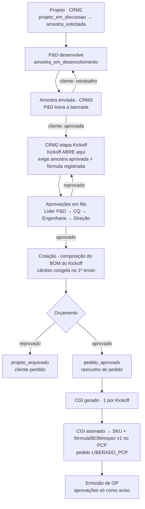
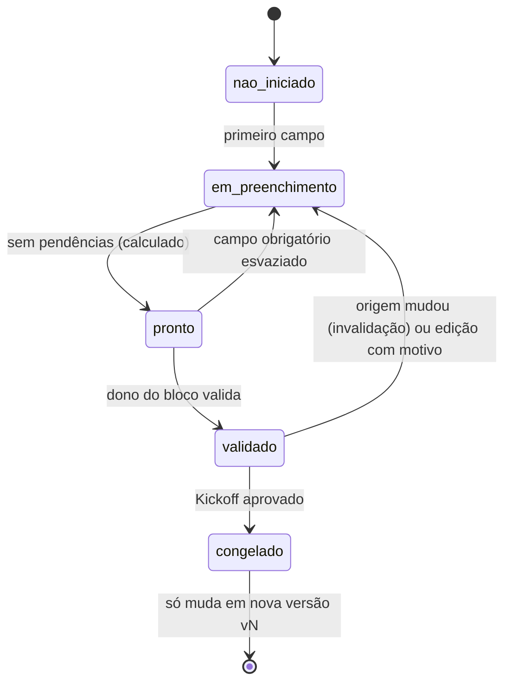

# RFC-001 — Projeto e Kickoff correndo em paralelo

Item ARQ-01 do `PROMPT_ENGENHARIA_PACOTE_20261021.md` · 22/10/2026 · **APROVADO pelo
usuário em 22/10/2026:**
- **D-1** donos de bloco como na seção 5;
- **D-2** opção A: o Kickoff nasce na criação do projeto;
- **D-3** V1 + V4, sem V2.

Os itens da Fase 3 (KO-*) e o "desatualizado" do AMO-05 são construídos sobre este modelo.

## 1. Problema

O fluxo é uma cascata: cada etapa espera a anterior terminar. O lead time de um projeto
é a soma de todas elas, embora quase todo o Kickoff (cliente, categoria, volume,
componentes, embalagem, serviços) já seja conhecido no briefing, semanas antes de a
amostra ser aprovada. O que precisa esperar a amostra é pouco: fórmula, especificação
técnica do granel e a parte do BOM que vem dela.

**Princípio:** separar **informação** de **compromisso**. Coletar, validar e estimar
correm em paralelo ao P&D. O que compromete dinheiro ou capacidade (SKU, pedido de
compra, OP) continua atrás de trava dura.

## 2. Como está hoje (conferido no código)



| Ponto | Onde |
|---|---|
| Etapas e transições do projeto | `crm-frontend/src/lib/crmRules.js:25–39` |
| Kickoff só abre nas etapas a partir de `kickoff` | `firebaseCommercial.js:892–896` |
| Prontidão por bloco já calculada (`blocos_status`: completo + campos pendentes), sem estado | `firebaseCommercial.js:170–178` |
| Versão do Kickoff aprovado (`vN`) com justificativa e `log_auditoria` | Fase 2 de 15/10 |
| Aprovação em sequência fixa | `firebaseCommercial.js:39` |
| Orçamento reprovado arquiva o projeto | `firebaseCommercial.js:1516` |
| SKU na assinatura do CGI | `firebaseCommercial.js:1130–1295` |
| Etapa do CRM2 pareada com o status da amostra | `lib/etapaPelaAmostra.js` |

## 3. As vertentes contra o código real

| Vertente | O que já existe | Custo aqui | Veredito |
|---|---|---|---|
| **V1 — Kickoff vivo, estado por bloco** | Metade: `blocos_status` calcula prontidão por bloco; falta estado, dono e proveniência | Moderado: um campo novo por bloco, abertura antecipada, ajuste no `crmRules` | **Adotar** |
| **V2 — Kickoff por SKU** | Nada | Alto: cotação e orçamento parciais; o cliente aprova o pacote | **Não adotar agora.** Decidir pela medição (seção 11) |
| **V3 — Grafo de dependências com eventos** | Gatilhos do Render existem (`onValueCreated`), sem barramento | O maior; exige reprocessamento e idempotência no servidor gratuito, que dorme | **Deixar o caminho aberto** (outbox, seção 6) sem construir |
| **V4 — Versões imutáveis** | Kickoff `vN` com justificativa já existe | Baixo: estender a cotação e o orçamento e acrescentar "desatualizado" com diff | **Adotar**, mantendo a numeração `vN` (não `rev.A`) |

**Decisão proposta: V1 + V4 agora, com outbox de eventos tratado no próprio adaptador.**
V1 dá o paralelismo de informação. V4 torna seguro começar com dado provisório: toda
mudança vira versão, diff e marca explícita, nunca sobrescrita silenciosa. A outbox
deixa V3 possível sem reescrita.

## 4. Modelo de dados (caminhos no RTDB)

```
erp/kuryos/kickoffs/{id}
  ...campos atuais (questionario_composicao, bom, aprovacoes, versao, versao_numero…)
  aberto_em_etapa: "projeto_em_discussao" | …        ← onde nasceu (V1)
  blocos_estado/{bloco0..bloco5, fechamento}:
     { estado, dono, aguardando: "pd" | null,
       atualizado_em, validado_por, validado_por_nome, validado_em }
  origem/{caminho.do.campo}:                          ← KO-02
     { fonte: "crm_client" | "crm_project" | "amostra" | "pd_formula" | "manual",
       fonte_id, atualizado_em, provisorio: bool,
       sobrescrito: bool, motivo, sobrescrito_por, sobrescrito_em }
  desatualizado: { desde, motivo, evento_id, diff: [{campo, de, para}] } | null

erp/kuryos/cotacoes/{id} (opção A, Q12) e crm_propostas/{id}
  kickoff_id, kickoff_versao                          ← sempre aponta para uma versão
  estimativa: bool                                    ← montada sobre bloco provisório
  desatualizado: { … }                                ← mesmo formato

erp/kuryos/eventos/{pushId}                            ← outbox (só cria)
  { tipo, entidade, entidade_id, payload, em, por, por_nome, tratado_em }
```

`.validate` nas regras:
- bloco `congelado` não volta;
- `eventos/*` só cria;
- `desatualizado` só some com nova versão ou com decisão registrada ("revisado, sem
  impacto").

## 5. Máquina de estados por bloco



- **"pronto" é calculado, nunca marcado à mão.** Vem da função de pendência do KO-03
  (`obrigatório ∧ visível ∧ vazio`).
- **"validado" é ação humana do dono do bloco.** Proposta de donos, que casa com as
  aprovações de hoje (decisão D-1):

  | Bloco | Dono |
  |---|---|
  | 0 identificação, fechamento | Comercial (KO-07) |
  | 1 formulação | Líder P&D |
  | 2–4 embalagens | Engenharia de Produto |
  | 5 qualidade | CQ |

- **"aguardando P&D".** O bloco 1, e o que depende da fórmula no BOM, fica assim até a
  amostra ser aprovada e a fórmula registrada. Não trava os outros blocos.
- **Aprovar o Kickoff** = todos os blocos validados + a sequência de aprovações atual
  (com a etapa Comercial nova) → todos viram `congelado`.

## 6. Eventos

Gravados pelo adaptador **no mesmo `update` multi-caminho** da mudança que os gera
(atomicidade de graça no RTDB), com o tratador rodando em seguida na mesma chamada.
`tratado_em` permite reprocessar o que falhar no meio.

| Evento | Quem gera | Efeito |
|---|---|---|
| `projeto.criado` | CRM2 | abre o Kickoff em rascunho (V1) |
| `amostra.aprovada` | retorno do cliente (CRM3) | campos do bloco 1 passam a acompanhar a amostra; "aguardando P&D" sai |
| `amostra.retrabalho_solicitado` | AMO-05 | Kickoff, cotação e orçamento baseados nela → `desatualizado` |
| `formula.versionada` | P&D | bloco 1 e MPs da cotação → `desatualizado` se já validados |
| `kickoff.bloco_validado` | dono do bloco | recalcula a prontidão |
| `kickoff.versionado` | revisão `vN` | cotação/orçamento da versão anterior → `desatualizado` com diff |
| `cotacao.aprovada` | Comercial | registro de câmbio (COM-01) |
| `orcamento.enviado` / `.aprovado` / `.reprovado` | Comercial | câmbio (COM-01); SKU (COM-07); reabre a cotação (COM-06) |
| `sku.gerada` | COM-07 | prontidão da OP |

## 7. Regras de invalidação

1. **Antes de validado**, campo autopopulado acompanha a origem sozinho (sem marca).
2. **Depois de validado**, mudança na origem → bloco volta a `em_preenchimento`, destino
   marcado `desatualizado` com diff e tarefa ao dono pelo `createOrReuseTask` que já
   existe. **Nunca sobrescrever dado validado em silêncio.**
3. **Congelado** não muda: a mudança exige nova versão `vN` com justificativa, o que já
   existe. A cotação e o orçamento da versão anterior ficam `desatualizado`.
4. **Sobrescrita manual** (KO-02) pede motivo, marca `sobrescrito` e o campo deixa de
   acompanhar a origem.
5. **Provisório** (seção 8) nunca vira orçamento aprovado.

## 8. Dado provisório

Campo com `origem.provisorio = true` (estimado no briefing, antes do P&D) aparece com o
selo "Provisório" e a origem. Cotação montada com algum bloco provisório nasce
`estimativa: true`, mostra "Estimativa" e **não pode virar orçamento aprovado**.
`decidirOrcamento` recusa com 409 `{codigo: "COTACAO_ESTIMATIVA"}`, e a regra
`.validate` confere o mesmo campo.

## 9. Prontidão

Uma função pura com fonte única (`crm-frontend/src/lib/prontidao.js` + cópia UMD em
`public/shared/prontidao.js`, com teste de igualdade):

```
calcularProntidao({ tipo: "kickoff" | "cotacao" | "op", dados, contexto })
  → { percentual, pronto: bool, pendencias: [{ codigo, bloco, campo, mensagem, onde_corrigir }] }
```

Quem usa:
- Kickoff, por bloco e no total;
- cotação ("pode enviar?");
- OP (PCP-02).

A tela só mostra o resultado; a trava fica no adaptador, na regra ou na função do
servidor.

## 10. Mudanças no CRM2

- O Kickoff nasce em **rascunho quando o projeto é criado** (decisão D-2; alternativa:
  na primeira solicitação de amostra).
- A etapa `kickoff` do funil continua, com o sentido "Kickoff em validação". O que muda
  é que ele já existe antes.
- A passagem para `cotacao` exige todos os blocos validados, ou cotação marcada como
  estimativa.
- `KICKOFF_STAGES` deixa de barrar a abertura.
- `etapaPelaAmostra` e o retorno do cliente passam a gerar eventos em vez de só mover a
  etapa.

## 11. Medição que decide a V2

Medido em 22/10 (`AUDITORIA_PACOTE_20261021.md` §6.4):
- 11 projetos com variação aprovada;
- 4 com mais de uma variação aprovada;
- **nenhum com aprovações em datas diferentes.**

As datas são da reconciliação de 14 e 15/10, não do cliente, então o sinal é fraco. Mas
não há nenhum caso de aprovação escalonada. **A V2 fica fora.** Se o COM-02 passar a
registrar a data real e aparecerem aprovações escalonadas, reavaliar.

## 12. Migração dos Kickoffs existentes

Script com ensaio e contagens; caminhos planos; um registro primeiro.
- `aprovado` → todos os blocos `congelado`; `vN` mantida; sem `origem` (legado).
- `em_preenchimento` / `aguardando_aprovacao` / `em_revisao` → estado calculado por
  bloco (`pronto` ou `em_preenchimento`), sem validação: o dono valida de novo.
- `arquivado` → não muda.
- Cotações e propostas existentes ganham `kickoff_versao` = versão vigente do Kickoff do
  projeto, quando houver.

## 13. Impacto por item

| Item | O que este RFC define para ele |
|---|---|
| AMO-05 | evento `amostra.retrabalho_solicitado` + `desatualizado` |
| KO-02 | `origem/{campo}` e as regras 1, 2 e 4 |
| KO-03 | "pronto" calculado pela função de pendência |
| KO-07 | dono do bloco 0 / etapa Comercial |
| BOM-01 | linhas do BOM com `origem` (questionário ou fórmula) e "aguardando P&D" |
| COM-01 | eventos `cotacao.aprovada` / `orcamento.*` disparam o registro de câmbio |
| COM-03 | cotação aponta para `kickoff_versao`; `estimativa` |
| COM-06 | `orcamento.reprovado` reabre a cotação em nova versão |
| COM-07 | `orcamento.aprovado` → SKU; estimativa barrada |
| PCP-02 | `calcularProntidao({tipo: "op"})` |

## 14. Riscos

- **Abrir o Kickoff cedo gera rascunho para projeto que morre.** Mitigação: arquivar o
  projeto arquiva o Kickoff (já é assim para status) e o rascunho não gera tarefa até
  alguém preencher.
- **Mais um estado para o usuário entender.** Mitigação: na tela, um chip por bloco com
  4 cores, e o "por quê" ao passar o mouse.
- **Tratador que falha no meio.** Mitigação: `tratado_em` vazio é reprocessado na
  próxima abertura do Kickoff (mesmo padrão da fila de MP nova, que já tenta de novo).

## 15. Estimativa

~3 dias para o núcleo (estado por bloco, origem, outbox, invalidação, migração, testes),
diluídos na Fase 3. As telas de cada KO-* entram no esforço de cada item.

## 16. O que preciso aprovado

- **D-1** Donos de bloco (tabela da seção 5).
- **D-2** O Kickoff nasce na criação do projeto, ou na primeira solicitação de amostra?
- **D-3** V1 + V4 com outbox, sem V2 (salvo se a medição da seção 11 mostrar o
  contrário).
